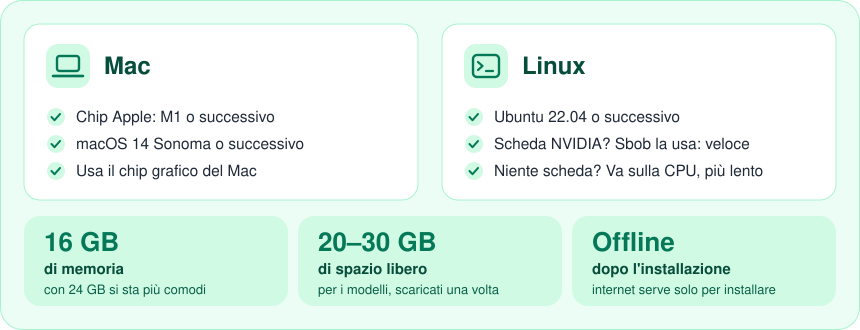

# Sbob

*[English](README.md)*

Sbob trasforma una registrazione (una lezione registrata col telefono, un video di YouTube, una
riunione) in **materiale di studio**: trascritto, capitoli, dispensa, mappa mentale, flashcard per Anki,
domande di autoverifica e glossario. **Tutto gira sul tuo computer**: nessun dato viene inviato a
servizi esterni.

> Ogni prodotto è generato automaticamente: **va sempre riletto**.

## Cosa fa

- **Ingresso**: un file audio o video trascinato nel browser, oppure un link (YouTube e le altre
  fonti supportate da [yt-dlp](https://github.com/yt-dlp/yt-dlp)).
- **Trascrizione** con timestamp e, a richiesta, **separazione delle voci** (chi parla).
- **Quattro profili**: 🎓 Lezione → Capitoli (predefinito), 👥 Riunione → Resoconto,
  🎙️ Intervista → Q&A, ⚖️ Confronto a due parti → Verbale del confronto.
- **Dispensa** su richiesta: il testo da studiare, discorsivo e continuo come una pubblicazione, senza
  minutaggio, **sintetica** o **approfondita**.
- **Mappa mentale** in vista **lineare** o **radiale**: clic per aprire/chiudere i rami, doppio clic per
  isolarne uno, ricerca dei nodi, navigazione da tastiera.
- **Prodotti di studio**: mappa mentale, flashcard (importabili in Anki), domande di
  autoverifica, glossario. Per le lezioni partono da soli; per gli altri profili con un pulsante.
- **Trascritto collegato all'audio**: un clic su un timestamp fa ripartire l'audio da lì.
- **Corsi** (es. «Analisi 1») con un **vocabolario** di nomi e sigle che migliora la trascrizione.
- **Storico permanente** ed export in **PDF** e **Markdown**.
- Interfaccia e prodotti in **italiano e inglese**.

## Cosa serve

Sbob fa tutto il lavoro sul tuo computer, quindi gliene serve uno abbastanza recente. Se hai un Mac
degli ultimi anni, o un buon PC con Ubuntu, quasi certamente sei a posto.

<p align="center"></p>

Non sei sicuro del tuo computer? Lancia l'installer: prima controlla tutto e ti dice in parole
semplici se manca qualcosa. Su un PC senza scheda NVIDIA Sbob funziona lo stesso, ci mette solo di
più (l'installer sceglie da solo un modello più leggero).

Windows arriverà più avanti.

## Installazione

### Mac

1. Scarica Sbob: da GitHub con **Code → Download ZIP** (poi scompatta), oppure
   `git clone https://github.com/BiofaOfficial/Sbob.git`. Metti la cartella dove vuoi, per esempio in *Download*.
2. Apri il **Terminale** (Applicazioni → Utility → Terminale), scrivi `cd ` (con lo spazio),
   trascina la cartella di Sbob nella finestra del Terminale e premi Invio.
3. Incolla questo comando e premi Invio:

   ```
   ./install.sh
   ```

Lo script controlla il Mac, installa ciò che serve (Homebrew, ffmpeg, Ollama, uv), scarica i
modelli (la prima volta ci vuole un po': sono alcuni GB) e crea l'app **Sbob**, in Applicazioni e
sulla Scrivania. La **separazione delle voci** (serve solo per riunioni, interviste e confronti) si
attiva dopo, da **Impostazioni**, incollando un token gratuito di Hugging Face: bisogna accettare le
condizioni dei modelli [pyannote/speaker-diarization-3.1](https://huggingface.co/pyannote/speaker-diarization-3.1)
e [pyannote/segmentation-3.0](https://huggingface.co/pyannote/segmentation-3.0).

**Per aggiornare**: scarica la nuova versione e rilancia `./install.sh` dalla sua cartella. Lo
storico non si tocca.

### Linux (Ubuntu 22.04 o successivo)

Stessi passi, ma il comando è:

```
./install-linux.sh
```

Sbob compare nel menu delle applicazioni e sulla Scrivania. Chiede la password solo per installare
i pacchetti di sistema. Se c'è una scheda NVIDIA con i driver installati (`nvidia-smi` funziona) la
usa da solo. Il supporto a Linux è recente: se qualcosa non va,
[apri una segnalazione](https://github.com/BiofaOfficial/Sbob/issues).

## Uso

1. Doppio clic su **Sbob** sulla Scrivania (o in Applicazioni): si apre il browser. Sbob lavora in
   sottofondo; per chiuderlo usa **Esci** in fondo alla barra a sinistra.
2. **Nuovo** → trascina il file (o incolla il link) → scegli il profilo → scegli il corso → **Avvia**.
3. Puoi chiudere il browser: il lavoro continua e il computer non va in stop finché non ha finito.
   Riapri Sbob per vedere il risultato.

Per un'ora di lezione servono indicativamente 15-30 minuti su Mac o con una scheda NVIDIA; sensibilmente di più con la sola CPU.

## Guida

Dentro Sbob, nella barra a sinistra, c'è la **Guida** completa all'uso.

## Dove stanno i dati

Tutto è nella cartella **`~/Sbob`** della tua utenza:

- `sbob.db`: lo storico;
- `lavori/`: le registrazioni e l'audio estratto;
- `config.toml`: le impostazioni (contiene il token di Hugging Face, se l'hai inserito).

Per fare il backup, o per spostare lo storico su un altro computer, basta copiare la cartella.

## Uso responsabile

- Usa i link solo per contenuti che **hai il diritto di scaricare**.
- Registra lezioni e riunioni solo **con il consenso** di chi parla, secondo le regole della tua
  università o del tuo ambiente di lavoro.

## Componenti di terze parti

| Componente | Uso | Licenza |
|---|---|---|
| [mlx-whisper](https://github.com/ml-explore/mlx-examples) (Mac), [faster-whisper](https://github.com/SYSTRAN/faster-whisper) (Linux) e il modello Whisper di OpenAI | trascrizione | MIT |
| [Ollama](https://ollama.com) | esecuzione locale dell'LLM | MIT |
| [Qwen2.5](https://huggingface.co/Qwen) (modello predefinito) | sintesi | Apache 2.0 |
| [pyannote.audio](https://github.com/pyannote/pyannote-audio) | separazione voci | MIT; i modelli sono **«gated»**: vanno accettate le condizioni su Hugging Face |
| [yt-dlp](https://github.com/yt-dlp/yt-dlp) | scaricamento da link | Unlicense |
| [FFmpeg](https://ffmpeg.org) | audio e video | LGPL/GPL |
| FastAPI, Uvicorn, httpx, Pydantic | server | MIT / BSD |
| [ReportLab](https://www.reportlab.com) | PDF | BSD |
| React, Vite, [D3](https://d3js.org), [markmap-lib](https://markmap.js.org), marked | interfaccia | MIT |

## Per chi sviluppa

```
./sbob-dev.sh test     # test con motori finti (funzionano anche su Linux)
./sbob-dev.sh lint     # controllo del codice con ruff
./sbob-dev.sh check    # verifica i motori veri su questo computer
./sbob-dev.sh run      # avvia dal sorgente
./sbob-dev.sh build    # ricompila il frontend (serve Node)
./sbob-dev.sh pacchetto [minor|major]   # nuova release
```

**Release**: `./sbob-dev.sh pacchetto` ricompila il frontend, lancia i test (e si ferma se falliscono),
alza la versione in tutti i file (1.0.8 → 1.0.9; `minor` → 1.1.0; `major` → 2.0.0), fa il commit di
**tutte** le modifiche presenti con il messaggio «Sbob <versione>» e crea `~/Desktop/Sbob-<versione>.zip`
da copiare sull'altro Mac. Lì: **Esci** da Sbob, scompatta lo zip in Download e lancia
`cd ~/Downloads/Sbob && bash install.sh`. Lo storico non si tocca.

Architettura: [`docs/ARCHITECTURE.md`](docs/ARCHITECTURE.md). Come contribuire: [`CONTRIBUTING.md`](CONTRIBUTING.md).

## Sicurezza

Sbob risponde solo a `127.0.0.1` e rifiuta le richieste che non arrivano da questo computer
(controllo di `Host` e `Origin`). Non ha login: non esporlo in rete. Per segnalare una vulnerabilità vedi
[`SECURITY.md`](SECURITY.md).

## Licenza

[MIT](LICENSE). I componenti di terze parti mantengono le proprie licenze (vedi tabella sopra).
