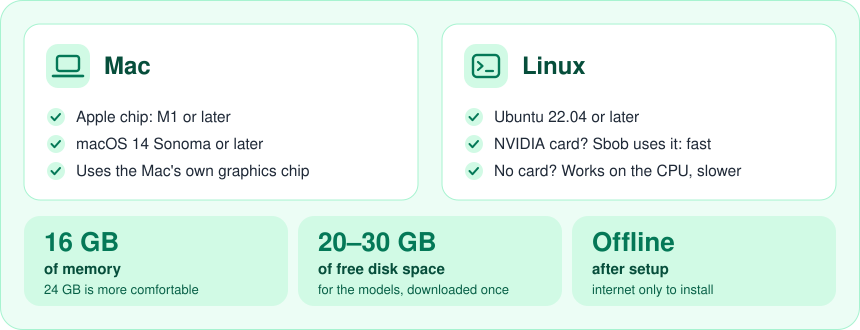

<p align="center"></p>

# Sbob

[](https://github.com/BiofaOfficial/Sbob/actions/workflows/ci.yml)
[](LICENSE)


*[Italiano](README.it.md)*

Sbob turns a recording (a lecture recorded on your phone, a YouTube video, a meeting) into
**study material**: transcript, chapters, study handout, mind map, Anki flashcards, self-assessment
questions and a glossary. **Everything runs on your computer**: no data is sent to external services.

> Every product is generated automatically: **always review it**.

## What it does

- **Input**: an audio or video file dropped in the browser, or a link (YouTube and the other
  sources supported by [yt-dlp](https://github.com/yt-dlp/yt-dlp)).
- **Transcription** with timestamps and, on request, **voice separation** (who speaks).
- **Four profiles**: 🎓 Lecture → Chapters (default), 👥 Meeting → Minutes,
  🎙️ Interview → Q&A, ⚖️ Two-party discussion → Discussion record.
- **Study handout** on request: continuous prose without timestamps, **concise** or **in depth**.
- **Mind map** in **linear** or **radial** view, with node search and keyboard navigation.
- **Study products**: flashcards (importable into Anki), self-assessment questions, glossary.
  Automatic for lectures; one button away for the other profiles.
- **Transcript linked to the audio**: click a timestamp and the audio plays from there.
- **Courses** (e.g. "Calculus 1") with a **vocabulary** of names and acronyms that improves the
  transcription.
- **Permanent history** and **PDF** / **Markdown** export.
- Interface and products in **Italian and English**.

## What you need

Sbob does all the work on your own computer, so it likes a reasonably recent one. If you have a
Mac from the last few years, or a decent PC with Ubuntu, you are most likely good to go.

<p align="center"></p>

Not sure about your machine? Just run the installer: it checks everything first and tells you in
plain words if something is missing. On a PC without an NVIDIA card Sbob still works, it simply
takes longer (the installer picks a lighter model for you).

Windows is planned.

## Installation

Get Sbob with `git clone https://github.com/BiofaOfficial/Sbob.git`, or use **Code → Download ZIP**
on GitHub and unzip it. Then open a terminal in the Sbob folder.

**Mac**

```
./install.sh
```

**Linux (Ubuntu 22.04 or later)**

```
./install-linux.sh
```

The script checks the computer, installs what is needed (ffmpeg, Ollama, uv; Homebrew on Mac),
downloads the models (several GB the first time) and creates the **Sbob** app: in Applications and
on the Desktop on Mac, in the applications menu and on the Desktop on Linux. It asks for your
password only to install system packages.

On Linux, an NVIDIA card is used automatically if its drivers are installed (`nvidia-smi` works).
Linux support is new: if something does not work, please [open an issue](https://github.com/BiofaOfficial/Sbob/issues).

**Voice separation** (only needed for meetings, interviews and discussions) is enabled later from
**Settings** by pasting a free Hugging Face token, after accepting the terms of the
[pyannote/speaker-diarization-3.1](https://huggingface.co/pyannote/speaker-diarization-3.1) and
[pyannote/segmentation-3.0](https://huggingface.co/pyannote/segmentation-3.0) models.

**To update**: `git pull` (or download the new version) and run the installer again. Your history is kept.

## Usage

1. Open **Sbob** from the Desktop (or from your applications): the browser opens. Sbob runs in the
   background; to quit it use **Quit** at the bottom of the left bar.
2. **New** → drop the file (or paste the link) → choose the profile → choose the course → **Start**.
3. You can close the browser: the job keeps running and the computer does not sleep until it is done.

An hour-long lecture takes roughly 15-30 minutes on a Mac or with an NVIDIA card; noticeably longer on CPU only. The full user guide is
inside Sbob, in the left bar.

## Where your data lives

Everything is in the **`~/Sbob`** folder of your user account: `sbob.db` (history), `lavori/`
(recordings and extracted audio), `config.toml` (settings, including the Hugging Face token if you
entered one). To back up or move your history, copy the folder.

## Security and privacy

Sbob only listens on `127.0.0.1` and rejects requests that do not come from your own computer
(`Host` and `Origin` checks). It has no login: do not expose it to a network. Details and how to
report a vulnerability: [SECURITY.md](SECURITY.md).

## Responsible use

- Only use links for content you **have the right to download**.
- Only record lectures and meetings **with the speakers' consent**, following the rules of your
  university or workplace.

## Third-party components

| Component | Used for | License |
|---|---|---|
| [mlx-whisper](https://github.com/ml-explore/mlx-examples) (Mac), [faster-whisper](https://github.com/SYSTRAN/faster-whisper) (Linux) and OpenAI's Whisper model | transcription | MIT |
| [Ollama](https://ollama.com) | running the LLM locally | MIT |
| [Qwen2.5](https://huggingface.co/Qwen) (default model) | summaries | Apache 2.0 |
| [pyannote.audio](https://github.com/pyannote/pyannote-audio) | voice separation | MIT; the models are **gated**: accept their terms on Hugging Face |
| [yt-dlp](https://github.com/yt-dlp/yt-dlp) | downloading from links | Unlicense |
| [FFmpeg](https://ffmpeg.org) | audio and video | LGPL/GPL |
| FastAPI, Uvicorn, httpx, Pydantic | server | MIT/BSD |
| [ReportLab](https://www.reportlab.com) | PDF | BSD |
| React, Vite, [D3](https://d3js.org), [markmap-lib](https://markmap.js.org), marked | interface | MIT/ISC |
| Atkinson Hyperlegible Next, Literata | fonts | SIL OFL 1.1 |

## Development

```
./sbob-dev.sh test     # tests with fake engines (also work on Linux)
./sbob-dev.sh lint     # ruff
./sbob-dev.sh check    # checks the real engines on this computer
./sbob-dev.sh run      # run from source
./sbob-dev.sh build    # rebuild the frontend (needs Node)
./sbob-dev.sh pacchetto [minor|major]   # new release: build, test, version bump, commit, zip
```

Architecture: [docs/ARCHITECTURE.md](docs/ARCHITECTURE.md). Contributing: [CONTRIBUTING.md](CONTRIBUTING.md).

## License

[MIT](LICENSE). Third-party components keep their own licenses.
